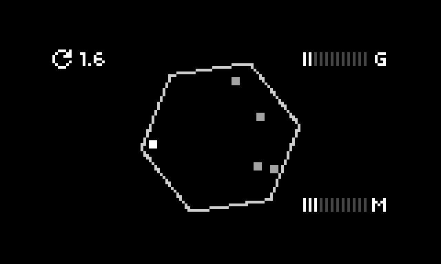

# rotere

tombola sequencer for norns - drop notes into a spinning shape and they play when they hit the walls.

lob atoms into a spinning box. the notes tumble around under gravity and play whenever they hit a wall, and the harder the hit, the louder the note. spin it either way, change the gravity, the bounce and the number of sides, or twist the walls open and let the notes fall out. it plays the built-in PolyPerc engine, a midi synth or both, and a midi keyboard can drop notes in. inspired by the tombola sequencer on the teenage engineering OP-1 and OP-1 field, with its own physics written from scratch.

*rotere* is norwegian / danish for "to rotate, spin, revolve".



**work in progress** - playable and stable on norns, things will change.

## requirements

- norns. per-note panning needs a recent norns update - on older ones polyperc is mono and panning is skipped
- optional: a midi keyboard to drop notes in, a midi synth to play out to

## install

```
;install https://github.com/mattbx/rotere
```

## controls

- E1 - spin (speed and direction, through zero to reverse)
- E2 - gravity
- E3 - mass (heavier = less bounce)
- K1 + E2 - sides (3 to 8)
- K1 + E3 - open (twist the walls and let the balls fall out)
- K2 - drop a ball (random note from the scale)
- K3 - empty it
- or play a midi keyboard - each key drops that note in

the screen keeps it simple: spin top left, gravity (G) and mass (M) on the right. hold K1 and sides + open show up bottom left.

## params

- **input** - midi in device and channel (omni by default)
- **output** - engine, midi, or engine + midi. midi device, channel and note length
- **notes** - root and scale (balls already in there retune when you change it), octaves, octave pick, transpose, probability, quietest hit, pan width
  - **octaves** - off, +1, +2, -1, -2, +/-1, +/-2. extra octaves a hit can land in
  - **octave pick** - arp (each ball climbs through the octaves hit by hit), random, or by wall (each wall has its own octave, so it turns with the shape)
  - **transpose** - +/-24 semitones, after the scale, so it shifts the key too
  - **probability** - chance each hit actually plays. skipped hits don't flash, and don't move the arp along
- **polyperc** - amp, release, cutoff, pw, gain
- **physics** - gravity, mass, ball-on-ball notes (off by default, it gets busy), show cpu (ball count and timings bottom left)

## notes

- up to 24 balls. 6-8 is the sweet spot.
- each note pans to where the ball hit (see requirements for older norns).
- gravity is relative to spin: the faster it spins, the more gravity it takes before the balls tumble instead of riding round the walls. riding the walls is fun too.
- if your synth echoes midi back in on the same port (midi thru), rotere ignores its own notes so the tombola doesn't fill itself.

## tests

rotere has off-device tests and screen previews that run in plain lua 5.3 - see `test/README.md`. the `norns_offline.lua` harness in there works for other norns scripts too.

## credits

- **tombola** - the original idea, from the teenage engineering OP-1 and OP-1 field.
- **Tombola for Max for Live** by Joel Powell (2022) - used as a reference for how it behaves. no code borrowed, rotere's physics are written from scratch.
- **PolyPerc** - the norns built-in engine.

this is an unofficial take, not affiliated with or endorsed by teenage engineering or Joel Powell.

## licence

MIT. see `LICENSE`.
