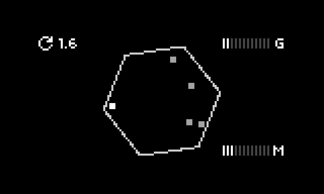

# rotere

lob atoms into a spinning box.

a tombola sequencer for norns. drop notes into a spinning shape and they tumble around under gravity, playing whenever they hit a wall. the harder the hit, the louder the note. inspired by the tombola sequencer on the teenage engineering OP-1 and OP-1 field.

*rotere* is norwegian / danish for "to rotate, spin, revolve".



**work in progress** - playable and stable on norns, things will change.

## controls

- E1 - spin (speed and direction, through zero to reverse)
- E2 - gravity
- E3 - mass (heavier = less bounce)
- K1 + E2 - sides (3 to 8)
- K1 + E3 - open (twist the walls and let the balls fall out)
- K2 - drop a ball (random note from the scale)
- K3 - empty it
- or play a midi keyboard - each key drops that note in

the screen keeps it simple: spin top left, gravity (G) and mass (M) on the right. hold K1 and sides + open show up bottom left.

## params

- **input** - midi in device and channel (omni by default)
- **output** - engine, midi, or engine + midi. midi device, channel and note length
- **notes** - root and scale (balls already in there retune when you change it), octaves, octave pick, transpose, probability, quietest hit, pan width
  - **octaves** - off, +1, +2, -1, -2, +/-1, +/-2. extra octaves a hit can land in
  - **octave pick** - arp (each ball climbs through the octaves hit by hit), random, or by wall (each wall has its own octave, so it turns with the shape)
  - **transpose** - +/-24 semitones, after the scale, so it shifts the key too
  - **probability** - chance each hit actually plays. skipped hits don't flash, and don't move the arp along
- **polyperc** - amp, release, cutoff, pw, gain
- **physics** - gravity, mass, ball-on-ball notes (off by default, it gets busy), show cpu (ball count and timings bottom left)

## notes

- up to 24 balls. 6-8 is the sweet spot.
- each note pans to where the ball hit. needs a recent norns update - on older ones polyperc is mono and panning is skipped.
- gravity is relative to spin: the faster it spins, the more gravity it takes before the balls tumble instead of riding round the walls. riding the walls is fun too.
- if your synth echoes midi back in on the same port (midi thru), rotere ignores its own notes so the tombola doesn't fill itself.

## install

```
;install https://github.com/mattbx/rotere
```

## credits

- **tombola** - the original idea, from the teenage engineering OP-1 and OP-1 field.
- **Tombola for Max for Live** by Joel Powell (2022) - used as a reference for how it behaves. no code borrowed, rotere's physics are written from scratch.
- **PolyPerc** - the norns built-in engine.

this is an unofficial take, not affiliated with or endorsed by teenage engineering or Joel Powell.

## licence

MIT. see `LICENSE`.
